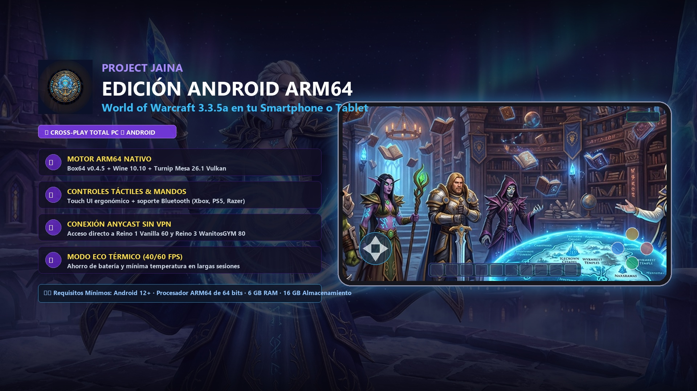

# ProjectJaina-Imito

**Tu Azeroth. Tu personaje. Ahora en tu móvil o tableta Android junto a jugadores de PC.**

**ProjectJaina-Imito** es el cliente oficial y soberano de **World of Warcraft 3.3.5a** para dispositivos móviles Android (ARM64, Android 12+), concebido para integrarse a la perfección con el clúster y los reinos de **JainaCore**:
* **Reino 1 — JainaCore** (Era Vanilla Cap 60 / Host Darck Perú)
* **Reino 3 — WanitosGYM** (Era WotLK ICC Cap 80 / Host Fran España)
* **Túnel Remoto Global Playit Anycast** (Conexión mundial en 1 clic sin lag ni apertura de puertos)

---

## ⚡ Características Principales

* 📱 **Experiencia de PC en Móvil:** Juega con tu mismo personaje, tu misma hermandad y en los mismos reinos que tus compañeros en ordenador.
* 🎮 **Soporte Dual de Controles:**
  * **Touch UI:** Interfaz táctil ergonómica con botones virtuales, D-Pad táctil y botones de acción adaptativos.
  * **ConsolePortLK:** Soporte nativo para mandos Bluetooth/USB (Xbox Wireless, PlayStation DualSense/DualShock, Razer Kishi, GameSir, AYN Odin 2).
* 🔋 **Modo ECO (40 FPS Cap):** Optimización térmica que reduce el consumo de batería hasta un 35% y previene el sobrecalentamiento en sesiones prolongadas.
* 🚀 **Pila de Emulación de Alto Rendimiento:**
  * Motor de traducción binaria **Box64 v0.4.5** con Dynarec optimizado.
  * Capa de compatibilidad **Wine 10.10** con parches dedicados de estabilidad de buffers.
  * Drivers gráficos **Mesa Turnip 26.1.0** (Snapdragon Adreno) y **Vortek 2.1 / VirGL** (MediaTek Mali / Dimensity).
* 🛡️ **Empaquetado y Seguridad L9:** Binario alineado a 4 bytes (`zipalign`) y firmado con certificado criptográfico oficial bajo el esquema **Android Signature Scheme v3**.
* ⚡ **Instalador USB 1-Clic para PC:** Asistente automatizado en PowerShell nativo y ADB portable que instala la APK, concede permisos de almacenamiento, transfiere datos a 80 MB/s e inyecta el `Config.wtf` calibrado sin fricción técnica.

---

## 📥 Descargas Oficiales y Verificación

| Archivo | Versión | Tamaño | Descripción / Enlace |
| :--- | :---: | :---: | :--- |
| [**`ProjectJaina-Imito-v1.0.apk`**](https://github.com/DarckRovert/ProjectJaina-Imito/releases/download/v1.0/ProjectJaina-Imito-v1.0.apk) | **v1.0** | **430.76 MB** | Cliente Oficial Android (Firma v3 / SHA-256: `A3BC...5F00`) |
| [**`ProjectJaina-Imito-Asistente-USB.zip`**](https://github.com/DarckRovert/ProjectJaina-Imito/releases/download/v1.0/ProjectJaina-Imito-Asistente-USB.zip) | **v1.0** | **4.18 MB** | Asistente Automatizado 1-Clic para Windows (ADB Embebido) |

> 🏷️ **GitHub Release Oficial:** [**Releases v1.0**](https://github.com/DarckRovert/ProjectJaina-Imito/releases/tag/v1.0)  
> 🌐 **Portal Web Oficial:** [**darckrovert.github.io/ProjectJaina_Web**](https://darckrovert.github.io/ProjectJaina_Web/#juego-movil)

---

## 🚀 Métodos de Instalación

### Método A: Asistente Automatizado por USB para PC (Recomendado - 2 Minutos)

1. Conecta tu teléfono Android al PC mediante cable USB con la **Depuración USB** activada.
2. Descarga y descomprime [**`ProjectJaina-Imito-Asistente-USB.zip`**](https://github.com/DarckRovert/ProjectJaina-Imito/releases/download/v1.0/ProjectJaina-Imito-Asistente-USB.zip).
3. Haz doble clic en `Instalador_ProjectJaina_Android.bat`.
   * El asistente detectará tu teléfono, instalará la APK oficial, concederá el permiso de almacenamiento automáticamente y te permitirá elegir entre:
     * **Modo Móvil Óptimo (~16 GB - Recomendado):** 60 FPS estables, cero cierres por falta de RAM y batería duradera.
     * **Modo HD Completo (~36 GB):** Texturas de PC para smartphones de gama alta.
4. Desconecta el cable, abre la aplicación en tu móvil y ¡a jugar!

### Método B: Instalación Manual

1. **Instala la APK:**  
   Descarga e instala `ProjectJaina-Imito-v1.0.apk`. Concede el permiso **"Acceso a todos los archivos"** en *Ajustes > Aplicaciones > Acceso especial*.
2. **Copia los archivos del juego:**  
   Copia los archivos de WoW 3.3.5a a:
   ```text
   Almacenamiento interno / WoW-Imito / Client /
   ```
3. **Elige tu reino y juega:**  
   Abre la app, ve a **Settings > Set realm** e ingresa la dirección:
   * **Conexión Global Anycast (Cero VPN):** `ambulance-ergonomic.tun.ply.gg`
   * **WiFi Local Casa:** `192.168.1.80`
   * **Reino 3 WanitosGYM (España Cap 80):** `100.98.162.75:8087`

---

## 📚 Documentación Técnica Detallada

* 📖 [**Guía de Instalación Paso a Paso**](docs/GUIA_INSTALACION_ANDROID.md) — Requisitos, comandos ADB y solución de incidencias.
* 🎮 [**Configuración de Mandos y Controles**](docs/CONFIGURACION_MANDOS.md) — Calibración de mandos Xbox/PS5/Odin 2 y layout táctil.
* ⚙️ [**Arquitectura Técnica del Runtime**](docs/ARQUITECTURA_TECNICA.md) — Detalle de emulación Box64, drivers Turnip y resiliencia de red.
* ⚖️ [**Modelo de Gobernanza**](GOVERNANCE.md) — Normas de desarrollo, licencias y preservación comunitaria.

---

## ⚖️ Licencia y Créditos

* **Licencia:** Distribuido bajo la licencia [GNU Lesser General Public License v2.1](LICENSE) (LGPL-2.1).
* **Proyecto Upstream:** Basado en la tecnología de emulación desarrollada por **Mr Anonymz** ([WoW-Imito](https://github.com/MrAnonymz/WoW-Imito)).
* **Ecosistema JainaCore:** Branding de Lady Jaina Proudmoore, asistente de despliegue USB y perfiles de conexión mantenidos por el equipo de ingeniería de **Project Jaina**.
